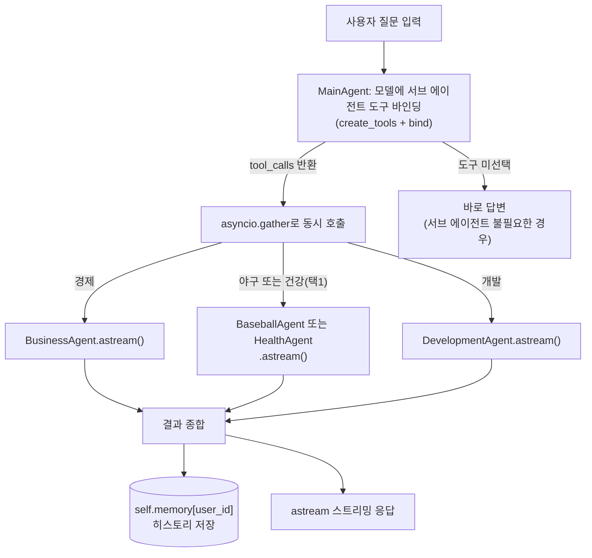

# 아키텍처 — 메인/서브 에이전트 오케스트레이션 설계 & 작업 분할 전략

관련 문서: [prd.md](prd.md), [multi-agent.md](multi-agent.md)

> ⚠️ 2026-08-10 방향 전환: 아래 "카테고리별 서비스를 4벌 따로 만드는 방식은 기각"했던 2026-08-07 결정을 뒤집고, 카테고리별 **서브 에이전트**를 두는 멀티 에이전트 구조로 전환함. 과거 결정과 그 이유는 이 문서 하단에 기록만 남겨둠(번복 배경 파악용).

## 메인/서브 에이전트 오케스트레이션 설계

FR-001("카테고리 추출")의 실제 구현 방식. `app/llms/agent.py`에 `Agent`/`SubLLM`/`MainLLM` 베이스 클래스를 두고, `MainAgent`(`app/llms/main_agent.py`)가 카테고리별 `SubLLM`(`app/llms/sub_agents.py`)을 도구로 호출한다.

- **1단계 — 도구 선택(라우팅)**: 카테고리 3종(경제/야구·건강 중 택1/개발)을 각각 `SubLLM` 서브클래스로 구현하고, `MainLLM.create_tools()`가 이들을 OpenAI 함수 호출 스키마로 변환해 모델에 바인딩. 사용자 질문을 넣으면 LLM이 어떤 서브 에이전트(들)를 호출할지 스스로 선택.
- **2단계 — 서브 에이전트 동시 호출**: 반환된 `tool_calls`를 `asyncio.gather`로 동시 실행 — 여러 카테고리에 걸친 질문이면 해당 서브 에이전트들이 병렬로 답변을 생성.
- **3단계 — 응답 종합 및 스트리밍**: 서브 에이전트 결과를 종합해 `astream`으로 스트리밍 반환, `user_id` 기준으로 `self.memory`에 히스토리 저장 → 후속 질문 시 이어받음.

### 설계 결정 및 근거

| 결정 | 이유 |
|---|---|
| 카테고리별로 독립된 `SubLLM` 서브클래스를 둠 | 각 카테고리가 자기 프롬프트·도구·메모리를 갖고 독립적으로 발전 가능 — 담당자별 작업 경계가 명확해짐 |
| 메인 에이전트가 `asyncio.gather`로 서브 에이전트를 동시 호출 | 여러 카테고리에 걸친 질문("경제랑 개발 뉴스 같이 알려줘")에서 순차 호출 대비 지연 시간 단축 |
| `MainAgent.memory`에 `user_id` 키로 히스토리 저장 | 후속 질문 시 이전 대화 맥락을 이어받기 위함(멀티유저 지원의 최소 요건) |
| 도구 미선택 시 서브 에이전트 없이 바로 응답 | 카테고리 경계가 애매한 질문에서 불필요한 서브 에이전트 호출 방지 |

## 작업 분할 전략 (2026-08-10 갱신)

**과거(2026-08-07) 결정 기록 — 카테고리별로 서비스 전체(검색+중복제거+요약+응답)를 4벌 따로 만들어 "나중에 취합"하는 방식은 기각했었음.**

당시 이유:
- 공통 로직(중복제거·요약·FastAPI·Pydantic)이 4벌로 중복되고 서로 다른 스타일로 갈라짐
- 필수요건 6종(FastAPI·Pydantic·SSE 등)이 카테고리 무관하게 서비스 전체에 하나씩 있어야 하는데, 4벌로 나누면 누가 책임지는지 애매해짐
- 통합이 마지막(8/14, 발표 전날/당일)에 몰리는 건 5일짜리 스프린트에 리스크가 큼
- 8/14 "무작위 팀원 지목"(전원이 데이터 흐름 전체를 설명할 수 있어야 함) 요건도, 각자 자기 카테고리만 알면 통과하기 어려움

**2026-08-10 번복 — 위 리스크를 감수하고 멀티 에이전트(서브 에이전트별 담당)로 전환.** 공통 로직 중복·통합 리스크는 `Agent`/`SubLLM`/`MainLLM` 공통 베이스 클래스(`app/llms/agent.py`)로 상당 부분 상쇄. 나머지 리스크(통합 시점, 전원 설명 가능 요건)는 여전히 유효하니 아래처럼 진행:

1. **공통 베이스 클래스는 이미 구축됨**(`app/llms/agent.py`) — `Agent`/`SubLLM`/`MainLLM`
2. 메인 에이전트(`app/llms/main_agent.py`)와 서브 에이전트 3개 슬롯(경제/야구·건강 택1/개발, `app/llms/sub_agents.py`)을 담당자별로 나눠 구현 — **담당 카테고리는 팀장 배정이 아니라 각자 자율 선택**(먼저 정하는 사람이 가져가고, 겹치면 그때 조율). `main_agent.py`는 `MainLLM` 계약(동시 호출·메모리·스트리밍)만 구현하고 구체적인 `SubLLM` 클래스는 몰라도 되도록 분리 — 실제 서브 에이전트들을 모아 `MainAgent(model, sub_llms)`로 조립하는 코드(야구·건강 택1 포함)는 앱 진입점(`app/main.py`) 쪽에서 담당
3. 빅뱅 통합 금지 — 매일 오후 스탠드업에서 조금씩 취합, `MainAgent.astream()`으로 실제 엔드투엔드 동작 계속 확인

## 역할 분담

| 역할 | 담당 | 주로 건드리는 파일 |
|---|---|---|
| 메인 에이전트 | 베이스 클래스·오케스트레이터(동시 호출, 메모리, 스트리밍) | `app/llms/agent.py`, `app/llms/main_agent.py` |
| 서브 에이전트 담당(3명) | `BusinessAgent`(경제), `BaseballAgent`(야구) 또는 `HealthAgent`(건강) 중 택1, `DevelopmentAgent`(개발) — 각 1개씩 담당(**자율 선택**) | `app/llms/sub_agents.py` |
| 설정 | 환경변수·설정 관리 | `app/setting.py` |
| 테스트·QA·발표 | 엣지케이스 테스트, 데모·발표 준비 | `tests/` |
