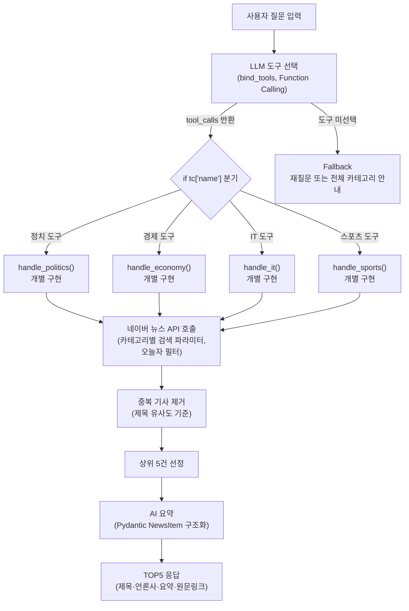

# 아키텍처 — 카테고리 라우팅 설계 & 작업 분할 전략

관련 문서: [prd.md](prd.md)

## 카테고리 라우팅 설계 (도구 선택 + 개별 분기 처리)

FR-001("카테고리 추출")의 실제 구현 방식. 팀 논의를 거쳐 다음으로 정리됨(2026-08-07):

**라우팅은 별도 분류 호출이 아니라 LLM의 도구 선택(Function Calling)으로 하고, 선택된 도구에 따라 분기해 카테고리별로 개별 처리한다.**

- **1단계 — 도구 선택(라우팅)**: 카테고리 4종(정치/경제/IT/스포츠, "기타" 없음)을 각각 `@tool`로 등록해 `bind_tools`로 LLM에 노출. 사용자 질문을 넣으면 LLM이 어떤 도구를 호출할지 스스로 선택 — 이 선택 자체가 라우팅 결정이며, 별도의 분류 전용 LLM 호출이 필요 없음.
- **2단계 — 분기 후 개별 처리**: 반환된 `tool_calls`를 순회하며 `if tc["name"] == "..."` 형태로 분기, 각 분기는 카테고리별로 **개별 구현된 처리 로직**(`app/services/categories.py`)을 실행.

### 설계 결정 및 근거

| 결정 | 이유 |
|---|---|
| 라우팅을 별도 분류 호출 대신 LLM 도구 선택(Function Calling)으로 수행 | `bind_tools` 한 번으로 "카테고리 결정 + 실행 인자(검색어) 추출"을 동시에 얻어 LLM 호출 횟수를 줄임 |
| 선택된 도구는 `if`/`elif`(`tc["name"]` 분기)로 처리하고, 각 분기는 카테고리별 개별 구현 | 도구 실행 루프에서 어떤 도구가 호출됐는지 확인해 분기하고, 카테고리마다 다른 로직(검색 파라미터·후처리)을 자유롭게 둠 — 공통 파라미터화 함수로 묶지 않아 카테고리별 확장에 유연함 |
| 도구 미선택 시 Fallback 경로 필수 | "이번 주 이슈 정리해줘"처럼 카테고리 경계가 애매한 질문에서 오분류·무응답 방지 |
| "기타" 카테고리는 두지 않음(팀 결정) | 도구 목록은 4개 고정 카테고리만 등록 — 별도 `search_other_news` 도구를 만들지 않고, 도구 미선택 시엔 위 Fallback 경로로만 처리(기타 뉴스는 서비스 범위에서 제외) |

## 작업 분할 전략

**카테고리별로 서비스 전체(검색+중복제거+요약+응답)를 4벌 따로 만들어 "나중에 취합"하는 방식은 기각.**

이유:
- 공통 로직(중복제거·요약·FastAPI·Pydantic)이 4벌로 중복되고 서로 다른 스타일로 갈라짐
- 필수요건 6종(FastAPI·Pydantic·SSE 등)이 카테고리 무관하게 서비스 전체에 하나씩 있어야 하는데, 4벌로 나누면 누가 책임지는지 애매해짐
- 통합이 마지막(8/14, 발표 전날/당일)에 몰리는 건 5일짜리 스프린트에 리스크가 큼
- 8/14 "무작위 팀원 지목"(전원이 데이터 흐름 전체를 설명할 수 있어야 함) 요건도, 각자 자기 카테고리만 알면 통과하기 어려움

**대신 다음 순서로 진행**:

1. **구현 리드가 8/10~11에 공통 스켈레톤 선구축** — 도구 등록/분기 껍데기(`app/tools/`, `app/routers/`), 중복제거(`app/services/dedup.py`), 요약(`app/services/summarize.py`), FastAPI 라우팅(`app/main.py`), Pydantic 스키마(`app/schemas/news.py`)
2. 스켈레톤 완성 후 `handle_정치()`/`handle_경제()`/`handle_it()`/`handle_스포츠()`(`app/services/categories.py`) **개별 함수 본문만** 4명이 나눠서 채움 — 이 조각은 실제로 병렬화하기 좋음. **어떤 카테고리를 맡을지는 팀장이 배정하지 않고 각자 정한다(자율 선택, 2026-08-07 결정)** — 먼저 정하는 사람이 가져가고, 겹치면 그때 조율
3. 빅뱅 통합 금지 — 매일 오후 스탠드업에서 조금씩 취합

## 역할 분담 (가제 — 실제 팀원 배정 전 초안)

| 역할 | 담당 | 주로 건드리는 폴더 |
|---|---|---|
| 팀장 | 카테고리 범위 결정·일정 조율·발표 총괄 | — |
| 구현 리드 | 네이버 뉴스 API 연동, LCEL 체인 구조, 엔드포인트 배선, 공통 스켈레톤 선구축 | `app/main.py`, `app/routers/`, `app/services/naver_news.py`, `app/services/dedup.py`, `app/tools/` |
| 프롬프트·기획 | 카테고리 추출·요약 프롬프트(RCIF), Pydantic 스키마 설계 | `app/services/summarize.py`, `app/schemas/news.py` |
| 테스트·QA·발표 | 엣지케이스(기사 0건·중복 과다·모호한 카테고리) 테스트, 데모·발표 준비 | `tests/` |
| 팀원 4명 공통 | `handle_정치()`/`handle_경제()`/`handle_it()`/`handle_스포츠()` 각 1개씩 담당(스켈레톤 완성 후, **담당 카테고리는 팀장 배정이 아니라 각자 자율 선택**) | `app/services/categories.py` |
