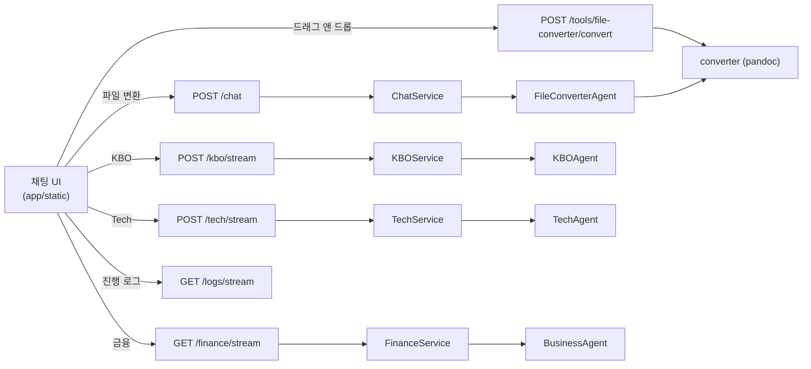

# 아키텍처 — 독립 에이전트를 하나의 FastAPI 앱으로 묶는 구조

관련 문서: [prd.md](prd.md) · [navigation.md](navigation.md) · [multi-agent.md](multi-agent.md)(채택하지 않은 대안)

> 이 문서는 현재 `main`의 코드 기준입니다. 초기 "뉴스봇"의 카테고리 라우팅 설계는 주제와 함께 폐기되어 이 문서에서 제거했습니다(경과: [prd.md](prd.md) 2절).

## 한눈에 보기

중앙 오케스트레이터(Main LLM)를 두지 않고, 팀원 각자가 독립 에이전트를 만들어 라우터로 등록합니다. 어떤 에이전트로 보낼지는 서버가 아니라 **채팅 UI의 에이전트 선택 버튼**([app/static/index.html](../app/static/index.html))이 정합니다.

## 계층

각 요청은 같은 3계층을 지납니다. 계층을 나눈 이유는 "라우팅 문제인가, 로직 문제인가"를 빠르게 좁히기 위해서입니다([course-reference.md](course-reference.md) 2절).

| 계층 | 위치 | 책임 | 하지 않는 일 |
|---|---|---|---|
| 라우터 | [app/routers/](../app/routers/) | 요청 검증, 서비스 호출, `StreamingResponse` 반환 | LLM 호출, 이벤트 조립 |
| 서비스 | [app/services/](../app/services/) | 에이전트 호출, SSE 이벤트·응답 조립 | HTTP 세부 사항 |
| 에이전트 | [app/llms/](../app/llms/) | 프롬프트·도구 호출·검증 파이프라인 | 전송 형식(SSE 등) 변환 |

의존성은 [app/dependencies.py](../app/dependencies.py)가 FastAPI `Depends`로 주입합니다. 상태를 인스턴스에 들고 있는 에이전트(`BusinessAgent` 등)는 요청마다 새로 만듭니다.

## 공통 베이스: `Agent(ABC)`

[app/llms/agent.py](../app/llms/agent.py)의 추상 메서드는 다섯 개입니다. 각 에이전트는 이것만 지키고, 내부 파이프라인은 자유롭게 구성합니다.

| 메서드 | 역할 |
|---|---|
| `create_system_prompt` / `create_human_prompt` | LLM의 역할·입력 형식 정의 |
| `create_workflow` | 프롬프트·모델·도구·검증을 조합한 실행 파이프라인 |
| `answer_validation` | 최종 답변 평가 |
| `astream` | 진행 상황을 `AsyncIterator`로 스트리밍(전송 형식 변환은 호출 측 담당) |

도구는 [app/tools/base.py](../app/tools/base.py)의 `BaseTool`(LangChain `BaseTool` + 공용 설정)을 상속합니다.

## 에이전트별 파이프라인

| 에이전트 | 도구 | 파이프라인 | 구조화 출력 |
|---|---|---|---|
| `FileConverterAgent` | `file_converter` | 프롬프트 → 도구 선택(Function Calling) → 도구 실행 → 도구 결과 검증 → 답변 생성 → 답변 검증 | `FileConversionAnswer`, `ToolResultCheck`, `AnswerCheck` |
| `KBOAgent` | `WebSearchTool`(KBO 도메인 한정), `DateTimeTool` | 도구 자율 호출(근거 수집) → 초안 → 검증 LLM → 불합격 시 근거 기반 수정 | `ValidationResult` |
| `TechAgent` | `CachedWebSearchTool` | `create_agent`로 검색·답변 → 출처·품질 검증 | `TechAgentResponse` |
| `BusinessAgent` | 주가·환율·금리 도구, `WebSearchTool` | `ToolSelectAgent` → `AnswerWriterAgent` → `AnswerEvaluatorAgent`, 불합격 시 재작성 루프 | `AnswerEvaluation` |

LLM은 모두 `gpt-4o-mini`, `temperature=0.0`입니다([app/dependencies.py](../app/dependencies.py)).

## 스트리밍 형식

에이전트별로 형식이 다릅니다. 프론트([app/static/chat.js](../app/static/chat.js))가 에이전트마다 파서를 따로 둡니다.

| 엔드포인트 | 응답 형식 | 이벤트 |
|---|---|---|
| `POST /chat` | `text/event-stream`, `data: {JSON}` | `tool_start` · `tool_end` · `answer_chunk` · `done` |
| `POST /tech/stream` | `text/event-stream`, `event: {type}` + `data: {JSON}` 두 줄 | `status` · `delta` · `result` · `error` |
| `GET /finance/stream` | `text/event-stream`, `data: {JSON}` 한 줄(타입은 JSON 안) | `answer` · `done` · `error` |
| `POST /kbo/stream` | `text/plain` 청크 스트림(SSE 아님) | — |
| `GET /logs/stream` | `text/event-stream` | 서버 로그 한 줄씩 |

`/chat`은 `with_structured_output`이 완성된 객체를 한 번에 돌려주므로 `answer_chunk`가 통째로 한 번 옵니다. 이벤트 상세는 [app/services/chat.py](../app/services/chat.py), [app/schemas/tech.py](../app/schemas/tech.py), [app/routers/finance.py](../app/routers/finance.py)에 있습니다.

## 설계 결정과 근거

| 결정 | 이유 |
|---|---|
| 중앙 오케스트레이터 폐기, 에이전트 독립 | 한 사람이 막혀도 다른 사람이 막히지 않게 하려는 팀 결정. 라우팅은 필요해지면 나중에 얹는다 — 검토했던 패턴은 [multi-agent.md](multi-agent.md) |
| 에이전트 선택은 UI 버튼 | 서버 측 라우팅 없이 에이전트를 독립 배포 가능하게 유지 |
| 공통 규약은 `Agent(ABC)`와 `BaseTool`만 | 최소한의 일관성만 강제하고 내부 구현의 자율성을 남김 |
| 무상태·멀티턴 미지원 | 5일 스프린트 범위 통제([06_open_questions.md](06_open_questions.md) DEC-001) |
| 프론트는 빌드 도구 없는 순수 HTML/CSS/JS | 구현 속도 우선, 어디서든 바로 실행([06_open_questions.md](06_open_questions.md) DEC-002) |
| 업로드 파일 경로는 허용 디렉터리 안으로 제한, 크기 20MB 상한 | 경로 탈출 방지([prd.md](prd.md) FR-CONV-003) |
