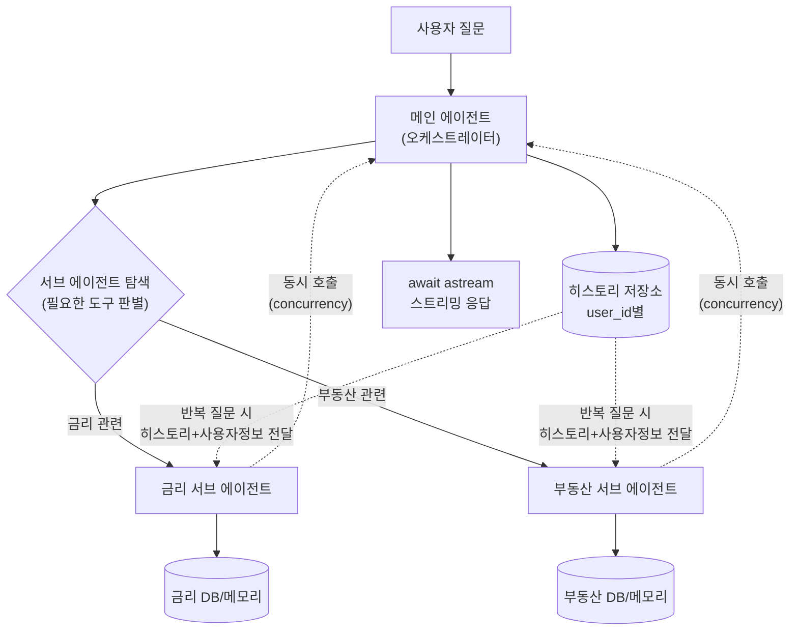

# 멀티 에이전트 설계 노트 — 메인/서브 에이전트 패턴

> ✅ 2026-08-10 팀 결정: 뉴스봇의 카테고리 라우팅을 이 문서의 패턴(메인 에이전트 + 카테고리별 서브 에이전트)으로 전환하기로 확정. 이 문서는 "금리/부동산 대출 금리" 질의를 예시로 정리한 **범용 패턴**이며, 실제 구현은 `app/llms/`(`agent.py`의 `Agent`/`SubLLM`/`MainLLM` 베이스 클래스, `main_agent.py`, `sub_agents.py`) — 카테고리는 예시의 금리/부동산 대신 경제/개발 + 야구·건강(택1, 한 명 담당). 상세는 [architecture.md](architecture.md) 참고.

## 시나리오

사용자: "한국은행 금리, 부동산 대출 금리 알려줘"

## 흐름 (초안)

1. 사용자 질문 입력
2. 메인 에이전트(오케스트레이터)가 질문을 분석해 필요한 서브 에이전트를 탐색 (예: 금리 에이전트, 부동산 에이전트)
3. 필요한 서브 에이전트를 도구(tool)로 **동시 호출** — 동시성 확보
4. 각 서브 에이전트는 자체 DB/메모리·도구를 이용해 비동기로 답변 생성
5. 메인 에이전트가 서브 에이전트 결과를 취합해 `await astream`으로 스트리밍 응답
6. 메인 에이전트는 **사용자 구분**을 반드시 유지 (멀티유저, 예: `user1`) — 요청마다 사용자 식별자 필요
7. 답변을 저장하고 사용자별 대화 히스토리 구성
8. 반복/후속 질문 시, 해당 사용자의 히스토리 + 사용자 정보를 서브 에이전트 호출 시 함께 전달 → 컨텍스트 연속성 확보

## 컴포넌트별 설계 포인트

| 구성요소 | 역할 | 설계 시 고려사항 |
|---|---|---|
| 메인 에이전트 | 서브 에이전트 탐색/라우팅, 사용자 식별, 히스토리 관리, 응답 스트리밍 | 서브 에이전트를 하드코딩 분기할지, 도구 목록에서 동적으로 선택(Function Calling)할지 — [architecture.md](architecture.md)의 라우팅 패턴 재사용 가능 |
| 서브 에이전트 (금리/부동산 등) | 도메인 전용 툴 호출, 자체 메모리/DB 접근 | 서브 에이전트 간 완전 독립인지, 공통 로직(요약·포맷팅)을 공유할지 |
| 동시성 | 여러 서브 에이전트 동시 호출 | 서브 에이전트 하나가 실패해도 나머지가 막히지 않도록 예외 격리 필요 |
| 메모리/히스토리 | `user_id` 기준 대화 이력 저장 | 저장 스키마(user_id, session_id, turn, 질문, 답변), 저장 시점(응답 완료 후 vs 스트리밍 중) |
| 스트리밍 (`await astream`) | 최종 응답 전달 | 서브 에이전트 결과를 모두 기다린 뒤 스트리밍할지, 부분 결과가 나오는 대로 스트리밍할지 |
| 사용자 구분 | 멀티유저 지원 | 요청에서 `user_id`를 어떻게 받을지(헤더/세션/토큰), 서브 에이전트에도 `user_id`를 넘겨 개인화 컨텍스트 사용할지 |

## 미결정 사항 (추가 논의 필요)

- 서브 에이전트 탐색: 정적 매핑 vs LLM 기반 동적 라우팅
- 서브 에이전트 일부 실패 시 처리 정책 (전체 실패 처리 vs 부분 응답 반환)
- 히스토리 저장소: 실제 DB(Postgres/Redis 등) vs 인메모리
- 이 패턴을 현재 뉴스봇 프로젝트에 적용할지, 별도 프로젝트/차기 확장으로 다룰지
